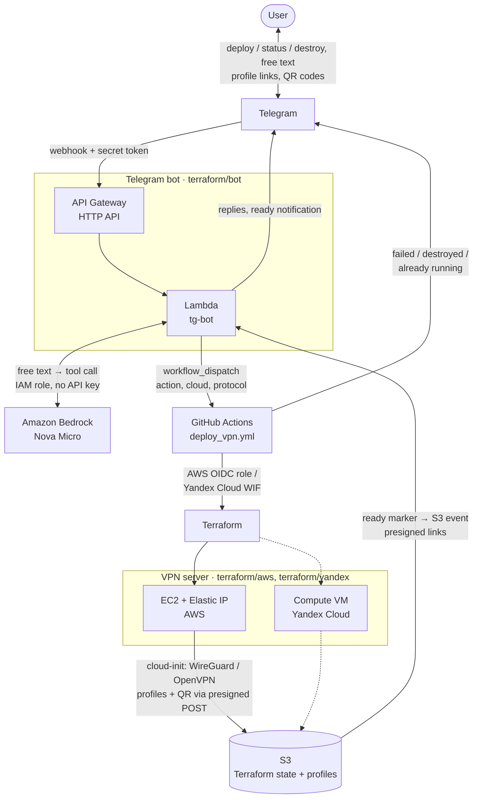

# VPN Telegram AI Bot

This project was created to demonstrate the capabilities of cloud engineering and process automation using various CI/CD and IaC tools.

By talking with the [Telegram chatbot](https://core.telegram.org/bots/api) in plain language (an AI model picks the action) or by tapping its buttons, the user can create his own [WireGuard](https://www.wireguard.com/) or [OpenVPN](https://openvpn.net/) server with a dedicated public IP address either in AWS (in the region of your choice) or in Yandex Cloud. When the work is done, the entire infrastructure can be automatically destroyed.

This is just an example of such an implementation that can be (and will be) endlessly improved in many ways.

<a href="url"></a>

## Quick start

Everything runs in your own AWS account and GitHub repository. You need [AWS CLI](https://aws.amazon.com/cli/) with admin credentials, [GitHub CLI](https://cli.github.com/) logged in with `gh auth login`, and [Terraform](https://developer.hashicorp.com/terraform/install) 1.10 or newer.

1. Create your copy: **Use this template → Create a new repository** on GitHub, then clone it.
2. Create a bot with [@BotFather](https://t.me/BotFather) (`/newbot`) and copy its token.
3. Get your chat ID from [@userinfobot](https://t.me/userinfobot): only the listed chat IDs can talk to the bot.
4. Create a [fine-grained GitHub token](https://github.com/settings/personal-access-tokens/new) for your new repository only, with the *Actions: Read and write* permission: the bot uses it to launch and read the workflows.
5. Run the setup from the clone and answer its questions (region, bucket name, the token and chat ID from above):

   ```bash
   scripts/setup.sh
   ```

   It creates the S3 bucket and the GitHub Actions role with `terraform/bootstrap`, sets the repository variables and secrets, checks the Amazon Bedrock quotas and runs the `deploy_bot.yml` workflow. Add `--dry-run` to see what it would do first; it is safe to run again later, for example to change the region or a token.
6. When the workflow is green, write `/start` to your bot.

The details of each piece are below.

## Tech Stack

**Cloud:** AWS, Yandex Cloud

**IaC:** Terraform

**VPN Server:** WireGuard or OpenVPN, Ubuntu 24.04 LTS, [cloud-init](https://cloud-init.io/)

**Telegram bot:** AWS Lambda (Python 3.13), AWS API Gateway (HTTP API)

**AI:** Amazon Bedrock (Amazon Nova Micro) with tool use for free-text messages, keyword parser as a fallback

**CI/CD:** GitHub Actions

Technically, the process is structured as follows:

When receiving a new message, Telegram calls a webhook configured in AWS API Gateway which launches a handler function in AWS Lambda. The webhook is protected with a secret token, and the bot only talks to allowed chat IDs. The function and the API are deployed with Terraform by GitHub Actions.

Depending on the selected action the bot will respond and launch the `deploy_vpn.yml` workflow in GitHub Actions with the target cloud and protocol. Before applying, the workflow generates a temporary presigned S3 POST that allows uploading files only under `profiles/<cloud>/`. Terraform creates the server with a static public IP and passes the bootstrap script, VPN configs and the upload credentials in the server's user data as a [cloud-init](https://cloud-init.io/) config (cloud-init is the standard first-boot initialization tool of cloud Linux images; the config is rendered by the `terraform/modules/cloud-init` module), so the server needs no cloud credentials at all. The script installs WireGuard (keys and a QR code per client) or OpenVPN (Certification Authority and certificates), configures IP forwarding and the firewall, builds client profiles and uploads them to S3, followed by a `ready` marker. The marker triggers an S3 event notification to the bot, which sends the download links (temporary S3 presigned URLs) and QR codes to the chat without being asked.

## Bot commands

| Menu command | Same as text | Action |
|---|---|---|
| `/deploy` | `deploy` | WireGuard server in AWS |
| `/deploy_openvpn` | `deploy openvpn` | OpenVPN on 443/tcp in AWS, for networks where UDP is blocked |
| `/deploy_yandex` | `deploy yandex` | WireGuard server in Yandex Cloud |
| `/deploy_yandex_openvpn` | `deploy yandex openvpn` | OpenVPN on 443/tcp in Yandex Cloud |
| `/status` | `status`, `profiles`, `link` | Last job status, profile links and QR codes |
| `/why` | `why` | Why the last job failed |
| `/destroy` | `destroy` | Destroy the AWS server, after confirmation |
| `/destroy_yandex` | `destroy yandex` | Destroy the Yandex Cloud server, after confirmation |

The menu is registered in Telegram by the bot deployment workflow. Menu commands cannot contain spaces, so the bot reads `_` as a space; any command also works as plain text, with or without the slash. A few extra text commands are not in the menu: `profile` (profile links only), `qr` (QR codes only, for the WireGuard mobile app) and `start` / `hi` (greeting).

Every reply of the bot carries a persistent keyboard with the main commands, so they are one tap away:

| | | |
|---|---|---|
| 🚀 Deploy | 🔐 Deploy OpenVPN | |
| 🚀 Deploy Yandex | 🔐 Deploy Yandex OpenVPN | |
| 📊 Status | 💥 Destroy | 💥 Destroy Yandex |

A button sends its label as a message, and the bot maps it to the matching command (`deploy yandex openvpn`, `status` and so on), so it works exactly like the typed command.

### Free text

Anything else can be written in plain words: *"spin up a VPN in Yandex that works over TCP"*, *"send me the QR code"*, *"why did the last deploy fail?"*, *"tear it down"*. Such messages go to [Amazon Nova Micro](https://aws.amazon.com/nova/) in Amazon Bedrock through the Converse API with tool use. The model only picks one of the bot's actions (`deploy`, `destroy`, `status`, `profiles`, `profile`, `qr`, `explain_failure`) and its arguments, or replies to small talk; the actions themselves are the same deterministic functions the commands use, and their arguments are validated before use.

- **Exact commands skip the model.** Keyboard buttons, menu commands (with or without `@BotName`) and `start` / `hi` go straight to the handlers, so they are instant and cost nothing.
- **Confirmation.** `destroy` always asks for an inline *✅ Yes, destroy* / *❌ Cancel* confirmation, whether it comes from a button, a command or free text. `deploy` from a button or a command starts at once, while `deploy` understood from free text is confirmed with *✅ Yes, deploy* / *❌ Cancel*, so a misunderstood message never launches a job. The confirmation carries the action in its callback data, so no state is stored; it expires after 10 minutes, and the buttons are removed once pressed.
- **Fallback.** If Bedrock fails, times out (8 s) or returns nothing usable, the message is handled by the keyword parser, so the bot keeps working without the model. An empty `bedrock_model_id` turns the model off completely.
- **Why it failed.** `/why` or a question about a failure fetches the log of the failed job of the last `deploy_vpn.yml` run through the GitHub API and asks the model, with no tools available, for a short explanation and the likely fix. The log is downloaded from GitHub's blob storage without the GitHub token. Without the model, the bot sends the end of the log.

WireGuard creates a profile per device (`phone` and `laptop` by default, see the `wireguard_peers` variable), since one WireGuard key cannot be used by two devices at the same time.

### Notifications

You do not have to poll `status` after `deploy`:

- when a new server has uploaded its profiles, it adds a `ready` marker to `profiles/<cloud>/`, the bucket notifies the bot's Lambda, and the bot sends the profile links and QR codes to every allowed chat;
- if the server was already running and nothing changed, the workflow says so right away;
- after `destroy` the workflow confirms that the server is gone (or that there was none);
- if a deploy or destroy job fails, the workflow sends the link to the run, and `/why` explains the reason.

## Architecture



## Repository layout

| Path | What |
|---|---|
| `terraform/bootstrap` | State bucket, GitHub OIDC provider and role, applied locally (state key `bootstrap/terraform.tfstate`) |
| `terraform/aws` | VPN server in AWS (state key `terraform/terraform.tfstate`) |
| `terraform/yandex` | VPN server in Yandex Cloud (state key `terraform/yandex.tfstate`) |
| `terraform/bot` | Telegram bot: Lambda, HTTP API, IAM, S3 notification for the `ready` marker (state key `terraform/bot.tfstate`) |
| `terraform/modules/cloud-init` | Renders the cloud-init config (bootstrap script, VPN configs, upload credentials) shared by both clouds |
| `scripts/setup.sh` | One-time setup of a copy of the repository: bootstrap, repository variables and secrets, bot deployment |
| `scripts/bootscript.sh`, `configs/` | Server bootstrap, WireGuard and OpenVPN configs |
| `telegram/` | The bot's Lambda handler (`handler.py`) and its offline tests (`tests/`) |
| `.github/workflows` | `deploy_vpn.yml` creates or destroys the server, `deploy_bot.yml` deploys the bot and registers its webhook and menu |
| `.github/scripts` | `presign_post.py` issues the upload credentials for the server, `notify.sh` sends the workflow's messages to the chat |

All states are stored in the same S3 bucket; the bucket and region are passed with `-backend-config`:

```bash
terraform -chdir=terraform/aws init -backend-config="bucket=<bucket>" -backend-config="region=<region>"
```

The bot, the VPN server and the bucket share one AWS region, the `AWS_REGION` repository variable. The bot names AWS servers after it (`eu-north-1` is *AWS Stockholm*, `us-east-1` is *AWS N. Virginia*); the optional `AWS_LOCATION` variable overrides the name.

## Tests

The bot's tests run offline, with Bedrock, S3, Telegram and GitHub mocked, so no credentials or packages are needed (Python 3.9+):

```bash
python3 -m unittest discover -s telegram/tests -v
```

## Setup

`scripts/setup.sh` (see [Quick start](#quick-start)) sets everything below except the Yandex Cloud variables. GitHub repository variables:

| Variable | Description |
|---|---|
| `GH_ROLE` | AWS IAM role assumed via GitHub OIDC, the `github_role_arn` output of `terraform/bootstrap` |
| `AWS_REGION` | AWS region of the bucket, the bot and the VPN server |
| `S3_BUCKET` | Bucket for Terraform states and client profiles |
| `TELEGRAM_ALLOWED_CHAT_IDS` | Comma-separated chat IDs allowed to use the bot |
| `BEDROCK_MODEL_ID` | Optional: Bedrock model or inference profile, `none` turns the model off (see below) |
| `AWS_LOCATION` | Optional: the name the bot gives AWS servers instead of the region's city |
| `YC_CLOUD_ID`, `YC_FOLDER_ID` | Optional: Yandex Cloud cloud and folder |
| `YC_SA_ID` | Optional: Yandex Cloud service account used by GitHub Actions |

GitHub repository secrets: `TELEGRAM_TOKEN`, `GH_TOKEN` (fine-grained token with `Actions: read and write` on this repository).

In a fork, as opposed to a copy made with *Use this template*, GitHub disables the workflows until you enable them on the *Actions* tab.

### Amazon Bedrock

The bot calls Bedrock with its Lambda role, so there is no API key to store. The model is Amazon Nova Micro through the cross-region inference profile of the region's geography: `eu.amazon.nova-micro-v1:0` in `eu-*` regions, `us.` in `us-*` and `apac.` in `ap-*`, so requests are served within that geography; elsewhere the model is called in the region itself. The role gets `bedrock:InvokeModel` on the profile and on the model in the regions it routes to. The `BEDROCK_MODEL_ID` repository variable (`bedrock_model_id` in `terraform/bot`) picks another model or profile, and `none` turns the model off. The bot's permissions boundary (see below) allows only Amazon Nova models, so apply `terraform/bootstrap` before deploying a bot version that uses Bedrock.

Check the account's Bedrock quotas in Service Quotas for your region (`scripts/setup.sh` prints them): *Cross-region model inference requests per minute* and *Model invocation max tokens per day* for Amazon Nova Micro. New and low-spend accounts may have them at 0, and these quotas can only be raised through an AWS Support case. Until then every call is throttled and the bot simply stays on keywords.

At about 2,000 input and 300 output tokens per message, the model costs a small fraction of a cent per message.

### Bootstrap

`terraform/bootstrap` manages what the workflows themselves depend on, so it is applied locally with admin credentials rather than by GitHub Actions:

- the S3 bucket: versioning, SSE-S3 encryption with SSE-C blocked, public access block, TLS-only bucket policy, lifecycle that keeps the last 5 old versions of every file and expires older ones after 30 days, and expires old versions of deleted client profiles after 1 day;
- the GitHub OIDC provider and the `GH_ROLE` role. An account can have only one GitHub OIDC provider, so an existing one is reused through `github_oidc_provider_arn` (`scripts/setup.sh` finds it). The role trusts only the `main` branch of this repository by GitHub's immutable OIDC subject, which includes the owner and repository IDs, so a repository recreated under the same name cannot assume it (repositories created before July 2026 may still issue the old `repo:<owner>/<repo>` subject, see `github_immutable_subject`). After a rename update `github_owner` / `github_repository`;
- a least-privilege inline policy of the role: the Terraform states and their locks, `profiles/`, the bucket notification, the VPN server in EC2, and the bot's Lambda, HTTP API, log group and IAM role;
- the permissions boundary of the bot's Lambda role. The GitHub role can write the bot role's policies only while this boundary is set, so it cannot grant itself more through the bot. Besides the logs and the profiles, the boundary allows invoking Amazon Nova models in Bedrock.

The settings live in `terraform/bootstrap/terraform.tfvars` (git-ignored, see `terraform.tfvars.example`), which `scripts/setup.sh` writes. The state is kept under `bootstrap/` in the bucket, out of the GitHub role's reach. Since the bucket does not exist before the first apply, that apply runs with a local state, which is then moved into the bucket; this is what the script does:

```bash
cd terraform/bootstrap
printf 'terraform {\n  backend "local" {}\n}\n' > local_backend_override.tf   # first run only
terraform init && terraform apply
rm local_backend_override.tf
terraform init -migrate-state -backend-config="bucket=<bucket>" -backend-config="region=<region>"
```

Later runs only need the last `init` (without `-migrate-state`) and `terraform apply`. A bucket and a role created by hand can be adopted instead of created: `import_existing = true` imports them with the `import` blocks in `imports.tf`.

### Yandex Cloud

GitHub Actions authenticates in Yandex Cloud with [Workload Identity Federation](https://yandex.cloud/en/docs/iam/concepts/workload-identity), no static keys are stored:

1. Create a service account with the `compute.editor` and `vpc.admin` roles on the folder.
2. Create an OIDC federation: issuer `https://token.actions.githubusercontent.com`, audience `https://github.com/<github_owner>`, JWKS `https://token.actions.githubusercontent.com/.well-known/jwks`.
3. Link the service account to the federation with the subject the repository issues, `repo:<github_owner>@<owner_id>/<repository>@<repository_id>:ref:refs/heads/main` (`gh api repos/<owner>/<repo>/actions/oidc/customization/sub` shows the prefix).
4. Set `YC_SA_ID`, `YC_CLOUD_ID` and `YC_FOLDER_ID` variables in the repository.

The server is created in the `ru-central1-d` zone, the `zone` variable of `terraform/yandex`. If Yandex Cloud restricts a zone (`Resource allocation is restricted` or `Zone … is not available` when the VM is created), switch the variable to another zone; the next deploy moves the zonal resources there.

## Versions

- [v1.0](https://github.com/eosklv/VPN-Telegram-AI-Bot/releases/tag/v1.0) — the original version: OpenVPN in AWS only, Telegram bot deployed with Serverless Framework.
- [v2.0](https://github.com/eosklv/VPN-Telegram-AI-Bot/releases/tag/v2.0) — AI assistant, WireGuard, Yandex Cloud, everything deployed with Terraform.
- [v3.0](https://github.com/eosklv/VPN-Telegram-AI-Bot/releases/tag/v3.0) — template repository with a one-script setup, no personal defaults, any AWS region.

## Author

- [Eugeny Sokolov](https://linkedin.com/in/esklv)
